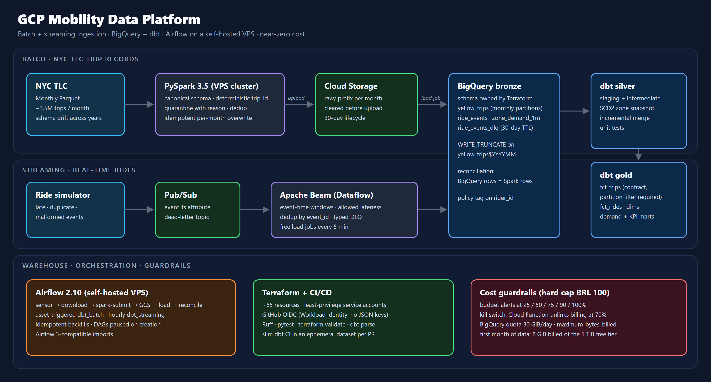
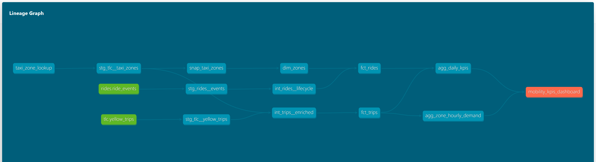
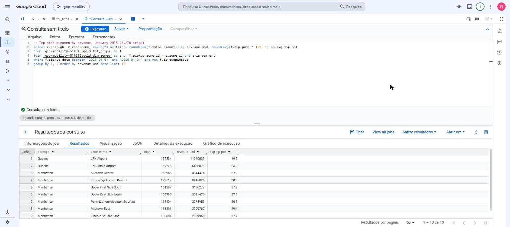
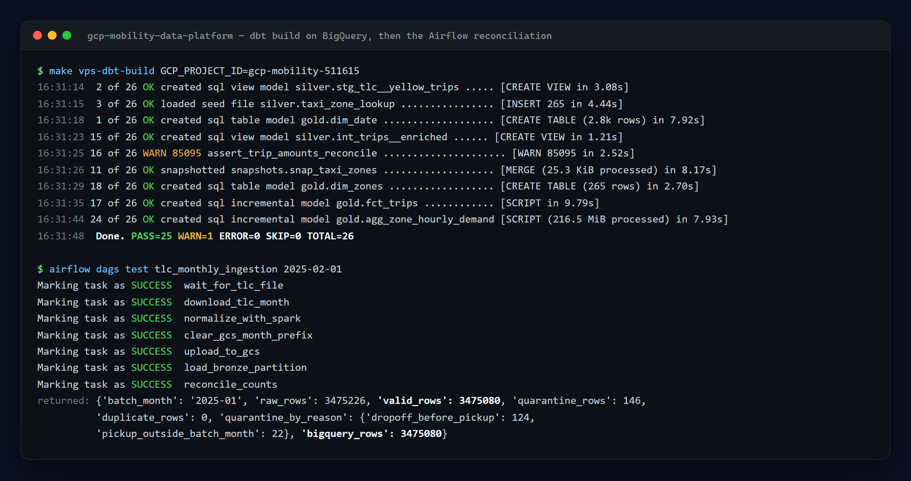

# GCP Mobility Data Platform

An urban mobility data platform on Google Cloud, modeled on what Uber and Lyft run in production. It is built on the public New York City taxi data ([NYC TLC](https://www.nyc.gov/site/tlc/about/tlc-trip-record-data.page)) and a real-time ride simulator.

> **Status:** skeleton. The structure, contracts and extension points are in place, and `TODO`s mark what is left to implement. The full plan is in [docs/design-doc.md](docs/design-doc.md).

## Architecture



## In action

**dbt lineage**, from the raw sources (green) to the KPI dashboard exposure (orange):



**The first month in BigQuery**: top pickup zones by revenue in `gold.fct_trips`, January 2025:



**Tests and reconciliation**: `dbt build` with every data test, then the Airflow DAG proving that BigQuery holds exactly the rows Spark validated:



## Runtime

Orchestration and Spark run on a self-hosted VPS that already hosts Airflow 2.10 and a Spark 3.5 cluster, so they cost nothing (see [docs/deploy-vps.md](docs/deploy-vps.md) and [ADR 0002](docs/adr/0002-local-airflow-instead-of-composer.md)). The Airflow scheduler mounts the project read-only. Spark jobs and TLC downloads therefore run inside the Spark master container via `docker exec`, and the scheduler only reads what they produce. Python 3.11 is used everywhere, matching the VPS containers. The DAGs are written to be Airflow 3-compatible.

## What each part demonstrates

| Area | Where | Highlights |
|---|---|---|
| Streaming | `pipelines/beam/` | Event time, fixed windows, late data with `allowed_lateness`, deduplication by `event_id`, typed DLQ, the same code on DirectRunner and Dataflow |
| Batch / backfill | `pipelines/spark/` | Normalizing *schema drift* across TLC years, deterministic IDs, quarantine with a reason, per-batch metrics |
| Transformation | `dbt/` | Incremental models (`insert_overwrite` and `merge`), SCD2 snapshot, model contracts, unit tests, integrity tests, cost guardrail in dev |
| Orchestration | `orchestration/airflow/` | Sensors, idempotent per-partition loads, data-aware scheduling (assets), dbt with a Cosmos path and a plain `dbt build` fallback |
| Infrastructure as code | `infra/terraform/` | Buckets, datasets, Pub/Sub with dead-lettering, least-privilege service accounts, Workload Identity Federation for GitHub, policy tags, budget and quota |
| DataOps | `.github/workflows/` | Lint (Ruff, SQLFluff), tests, `terraform validate`, *slim CI* `dbt build` in an ephemeral dataset per PR |
| Performance and cost | `docs/query-optimization.md`, `dbt/analyses/` | Before/after measured through `INFORMATION_SCHEMA.JOBS` |

## Validated so far

| What | Where | Result |
|---|---|---|
| Spark normalization of TLC 2025-01 | VPS Spark 3.5 cluster | 3,475,226 raw rows → 3,475,080 valid, 146 quarantined (124 `dropoff_before_pickup`, 22 `pickup_outside_batch_month`), 0 duplicates, ~90 s |
| Parquet output vs. BigQuery contract | Spark output schema | Types match: `DATETIME` via INT64 with `isAdjustedToUTC=false`, `NUMERIC(12,2)` for money |
| Streaming end to end | Pub/Sub emulator on the VPS | 1,117 messages published (5% duplicates, 5% late, 2% malformed) → 1,047 unique events, 21 to the DLQ, 275 window rows, including a LATE pane that corrected an already-emitted window |
| Test suites | Local and VPS | Simulator 4, Beam 19, Spark 3 (on the VPS cluster), Airflow DAG integrity 7 (on the VPS Airflow 2.10.4); `dbt parse` clean; `terraform validate` clean |

## Layout

```
.
├── docs/                   design doc, ADRs, SLOs, runbooks, optimization report
├── infra/terraform/        all GCP infrastructure
├── simulator/              ride event generator → Pub/Sub
├── pipelines/
│   ├── beam/               streaming: Pub/Sub → BigQuery bronze
│   └── spark/              batch: TLC Parquet → normalized Parquet
├── dbt/                    silver and gold in BigQuery
├── orchestration/airflow/  DAGs and integrity tests
└── .github/workflows/      CI, dbt per PR, Terraform
```

## Cost

The project is designed to fit in the GCP free tier. Details are in [ADR 0003](docs/adr/0003-bigquery-cost-guardrails.md).

| Resource | Strategy |
|---|---|
| BigQuery | Free tier (1 TiB of queries and 10 GiB of storage per month). Load jobs are free. `maximum_bytes_billed` on every dbt profile and an optional daily query quota on the project |
| Cloud Storage | 5 GB free in `us-central1`, with a lifecycle rule that deletes old `raw/` data |
| Pub/Sub | 10 GiB/month free. The local emulator is used for development |
| Dataflow | No free tier. Develop on DirectRunner; occasional Dataflow runs are paid with trial credits |
| Airflow and Spark | Self-hosted VPS. Cloud Composer is not used ([ADR 0002](docs/adr/0002-local-airflow-instead-of-composer.md)) |
| Budget | US$1 alert via Terraform |

## How to run and test

The steps go from "nothing but a laptop" to "full cloud". Steps 1 to 4 need **no GCP account and cost nothing**.

| Step | Needs | What you get |
|---|---|---|
| [1. Set up](#1-set-up) | Python 3.11, Java 17, Terraform, `make` | Virtual environments |
| [2. Run the tests](#2-run-the-tests) | Step 1 | Unit tests, dbt and Terraform validation |
| [3. Streaming on the Pub/Sub emulator](#3-streaming-on-the-pubsub-emulator) | Step 1 + `gcloud` CLI | Simulator → Pub/Sub → Beam, end to end |
| [4. Batch on the Spark cluster](#4-batch-on-the-spark-cluster-vps) | SSH access to the VPS | A real TLC month normalized by `spark-submit` |
| [5. Full cloud run](#5-full-cloud-run-gcp) | GCP project with billing | Bronze, silver and gold in BigQuery, orchestrated by Airflow |

On Windows, run the `make` targets from WSL. PySpark cannot start its JVM from native Windows Python.

### 1. Set up

```bash
git clone https://github.com/rodrigo85/gcp-mobility-data-platform.git
cd gcp-mobility-data-platform
make venvs        # one virtual environment per component, in .venvs/
make help         # lists every target
```

Create a `.env` file at the repository root (git-ignored). The Makefile loads it automatically:

```bash
GCP_PROJECT_ID=your-project-id       # use local-project for the emulator (step 3)
GCP_REGION=us-central1               # everything in us-central1 for the GCS free tier
GCS_BUCKET=your-project-id-mobility-lake
PUBSUB_TOPIC=ride-events
PUBSUB_SUBSCRIPTION=ride-events-beam
DBT_TARGET=dev
DBT_DEV_DATASET_PREFIX=dev_yourname
DBT_MAXIMUM_BYTES_BILLED=10000000000 # 10 GB cap per query
LOCAL_DATA_DIR=./data
```

### 2. Run the tests

```bash
make check
```

`make check` runs everything that works offline:

| Target | What it checks | Expected |
|---|---|---|
| `make test-simulator` | Event generation, chaos injection, reproducibility | 4 passed |
| `make test-beam` | Contract validation, DLQ routing, dedup, late data and windows with `TestStream` | 19 passed |
| `make test-spark` | Schema drift across TLC years, quality rules, deterministic `trip_id` | 3 passed |
| `make dbt-parse` | Jinja, refs, YAML, model contracts and unit test definitions | No errors or warnings |
| `make tf-check` | `terraform fmt` and `validate` (no credentials needed) | `Success! The configuration is valid.` |

Lint: `make lint` (Ruff, SQLFluff, `terraform fmt`).

The Airflow DAG integrity tests need an Airflow install. They run in CI (Airflow 2.10.4 with official constraints) and on the VPS with `make vps-dag-test` (expected: 7 passed).

### 3. Streaming on the Pub/Sub emulator

The emulator ships with the `gcloud` CLI (`gcloud components install pubsub-emulator`, or the `google-cloud-cli-pubsub-emulator` apt package) and needs Java.

```bash
# Terminal 1: emulator
gcloud beta emulators pubsub start --project=local-project --host-port=127.0.0.1:8085

# Terminal 2: Beam pipeline (DirectRunner, logs every output row)
export PUBSUB_EMULATOR_HOST=127.0.0.1:8085 GCP_PROJECT_ID=local-project
make emulator-topics      # creates the topic and subscription (idempotent)
make beam-local

# Terminal 3: simulator (20 rides/s for 5 min, with late, duplicate and malformed events)
export PUBSUB_EMULATOR_HOST=127.0.0.1:8085 GCP_PROJECT_ID=local-project
make simulate
```

What to look for in the Beam log:
- `ride_events {...}`: valid events. Duplicates published by the simulator appear only once.
- `ride_events_dlq {...}`: malformed messages, with the rejection `error`.
- `zone_demand_1m {...}`: one row per zone and window. A `'pane_timing': 'LATE'` row is a correction of a window that was already emitted, caused by a late event.

### 4. Batch on the Spark cluster (VPS)

Runs on a self-hosted Airflow 2.10 + Spark 3.5 server reached through an SSH alias (`VPS`, default `vpsmouts`). See [docs/deploy-vps.md](docs/deploy-vps.md) for the topology.

```bash
make vps-deploy                          # rsync the repository (no data, venvs or secrets)
make vps-setup                           # isolated venvs: dbt and Beam; runs dbt deps
make vps-dag-test                        # DAG integrity tests on the VPS Airflow -> 7 passed
make vps-download MONTH=2025-01          # downloads one TLC month (~60 MB), idempotent
make vps-spark-normalize MONTH=2025-01   # spark-submit inside the Spark master container
```

The job logs its batch metrics at the end:

```
batch metrics: {"batch_month": "2025-01", "raw_rows": 3475226, "valid_rows": 3475080,
 "quarantine_rows": 146, "duplicate_rows": 0, ...}
```

Output, under `data/normalized/yellow_trips/` in the project directory on the VPS:
- `valid/batch_month=2025-01/`: Parquet ready to load into `bronze.yellow_trips`.
- `quarantine/batch_month=2025-01/`: rejected rows, with `_dq_reasons`.
- `_metrics/batch_month=2025-01/`: the metrics above, as JSON.

Running the same month again overwrites these outputs, so the result is identical.

### 5. Full cloud run (GCP)

Needs a GCP project linked to a billing account (the free tier requires one). The commands below run on the VPS, which already has `gcloud`, Terraform and the Airflow/Spark containers. Expected cost for a one-month test is zero; the hard cap is described in [ADR 0003](docs/adr/0003-bigquery-cost-guardrails.md).

> **Secrets never leave the VPS.** The service account key is created directly in `.secrets/` (git-ignored, excluded from `rsync`, mode 600). Tokens are read from `gcloud` into environment variables and never written to files, logs or the repository.

**5.1 Log in** (interactive, once):

```bash
gcloud auth login --no-launch-browser
```

**5.2 Infrastructure.** Copy `infra/terraform/terraform.tfvars.example` to `terraform.tfvars` (git-ignored) and fill in `project_id` and `billing_account_id`. Keep `budget_currency_code` equal to your billing account currency. Then:

```bash
cd infra/terraform
export GOOGLE_OAUTH_ACCESS_TOKEN=$(gcloud auth print-access-token)   # short-lived, never stored
terraform init
terraform plan -out=tfplan        # review: ~65 resources, all free while idle
terraform apply tfplan
```

Check that the guardrails are live:

```bash
gcloud billing budgets list --billing-account=<BILLING_ACCOUNT_ID>                  # budget in your currency
gcloud functions describe budget-kill-switch --region us-central1 --format='value(state)'   # ACTIVE
bq ls <PROJECT_ID>:bronze                                                            # 4 tables
```

**5.3 Airflow credentials** (details in [docs/deploy-vps.md](docs/deploy-vps.md#gcp-credentials)):

```bash
gcloud iam service-accounts keys create .secrets/orchestrator.json \
  --iam-account mobility-orchestrator@<PROJECT_ID>.iam.gserviceaccount.com
chmod 600 .secrets/orchestrator.json

KEY=/pipeline/gcp-mobility-data-platform/.secrets/orchestrator.json
docker exec da-airflow-scheduler airflow connections add mobility_gcp \
  --conn-type google_cloud_platform --conn-extra "{\"key_path\": \"$KEY\", \"project\": \"<PROJECT_ID>\"}"
docker exec da-airflow-scheduler airflow variables set mobility_config \
  "{\"gcp_project\": \"<PROJECT_ID>\", \"gcs_bucket\": \"<PROJECT_ID>-mobility-lake\", \"gcp_keyfile\": \"$KEY\"}"
```

**5.4 Test in layers, Airflow last.** Each layer runs on its own, so a failure points at one component instead of a DAG run waiting on retries. The commands run from your machine (WSL on Windows) against the VPS:

| # | Command | What it proves | Cost | Expected |
|---|---|---|---|---|
| a | `make vps-download MONTH=2025-01` | TLC download (idempotent) | 0 | `downloaded: ... (59158238 bytes)` or `already downloaded` |
| b | `make vps-spark-normalize MONTH=2025-01` | Spark job on the cluster | 0 | `batch metrics: ... "valid_rows": 3475080, "quarantine_rows": 146` |
| c | `make vps-dbt-unit GCP_PROJECT_ID=<PROJECT_ID>` | dbt unit tests on fixture rows | ~0 bytes | `PASS=2` |
| d | `make vps-dbt-build GCP_PROJECT_ID=<PROJECT_ID>` | Silver and gold, with every data test | ~1 GiB of the 1 TiB free tier | `PASS=25 WARN=1 ERROR=0` (the warning is a known source issue, see [docs/data-quality-findings.md](docs/data-quality-findings.md)) |
| e | DAG `tlc_monthly_ingestion` (below) | The full orchestrated chain, GCS load included | 0 (loads are free) | 7 tasks `SUCCESS`, `'bigquery_rows': 3475080` |

Step (d) needs bronze loaded, which happens in (e) the first time. On a fresh project, run (e) right after (b).

For (e), `airflow dags test` runs a single DAG run in the foreground without unpausing anything. The logical date `2025-02-01` processes the 2025-01 month:

```bash
DAGS=/opt/airflow/dags/gcp-mobility-data-platform/orchestration/airflow/dags
docker exec da-airflow-scheduler airflow dags test -S $DAGS tlc_monthly_ingestion 2025-02-01
```

Run it twice: the counts stay the same, which proves the partition load is idempotent.

Verify in BigQuery:

```bash
bq query --use_legacy_sql=false \
  'select count(*) trips, round(sum(total_amount), 2) revenue from `<PROJECT_ID>.gold.fct_trips` where pickup_date between "2025-01-01" and "2025-01-31"'
```

**5.5 Cost check** (bytes billed by every query today; the free tier is 1 TiB/month):

```bash
bq query --use_legacy_sql=false \
  'select round(sum(total_bytes_billed)/pow(1024,3), 2) gib_billed from `region-us-central1`.INFORMATION_SCHEMA.JOBS where date(creation_time) = current_date()'
```

**5.6 Go live.** Unpause `tlc_monthly_ingestion` (it backfills every month since 2025-01; narrow `start_date` first to load fewer months), `dbt_batch` (starts whenever bronze is updated) and `dbt_streaming` (hourly).

**5.7 Streaming on Dataflow** (no free tier; uses trial credits): `make beam-dataflow`, with `make simulate` pointing at the real topic (unset `PUBSUB_EMULATOR_HOST`).

## Documentation

- [Design doc](docs/design-doc.md)
- [ADRs](docs/adr/)
- [Data SLOs](docs/data-slos.md)
- [Data quality findings](docs/data-quality-findings.md)
- [Query optimization report](docs/query-optimization.md)
- [VPS deployment](docs/deploy-vps.md)
- [Runbook: streaming backlog](docs/runbooks/streaming-backlog.md)

## License

MIT
